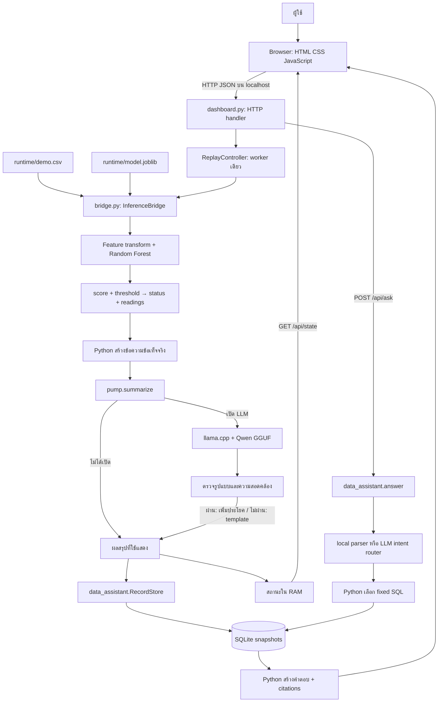

# อธิบายระบบ Pump Maintenance Offline แบบครบเส้นทาง

ฉบับอธิบายโค้ดใน working tree ณ 29 ตุลาคม 2026 สำหรับอ่านทำความเข้าใจ ทำรายงาน และเล่านำเสนอ งานนี้ตรวจบน Windows PC ไม่ใช่การตรวจ Pi สด และไม่ได้รัน GGUF เพื่อยืนยันผลใหม่

## 1. โปรเจกต์นี้ทำอะไร

ระบบนำข้อมูลเครื่องจักรทีละแถวจาก CSV มาประเมินด้วยโมเดล Machine Learning ที่เทรนไว้ แล้วแสดงสถานะและข้อความไทยบนเว็บในเครื่อง ผลที่ประมวลเสร็จเก็บใน SQLite เพื่อเปิดประวัติและถามคำถามที่ระบบรองรับได้ แม้ไม่เชื่อมต่ออินเทอร์เน็ต

มีโมเดลสองบทบาทแยกจากกัน:

| ส่วน | รับอะไร | ทำอะไร | ส่งออกอะไร |
|---|---|---|---|
| ML classifier | ชนิดผลิตภัณฑ์และค่าเซนเซอร์ | คำนวณคะแนนเพื่อเทียบ threshold | score และ status |
| Local LLM (ทางเลือก) | ข้อความข้อเท็จจริง หรือคำถามผู้ใช้ | เลือกประโยค A/B หรือประเภทคำถาม | ตัวอักษร A/B หรือ intent |

Python เป็นผู้ควบคุมกระบวนการทั้งหมด: ตรวจข้อมูล เรียกโมเดล ตรวจผล LLM อ่านเขียนฐานข้อมูล และประกอบคำตอบ เว็บทำหน้าที่ส่งคำสั่งและแสดงผล

เดโมหลักใช้ AI4I ซึ่งเป็นข้อมูลสังเคราะห์ของกระบวนการผลิต ไม่ใช่ข้อมูลปั๊มจริง ระบบปัจจุบันเป็น snapshot classification จาก CSV replay ไม่ใช่ live monitoring ไม่ทำนายเวลาที่เหลือก่อนเสีย (RUL) และไม่มีการสั่งเปิดปิดเครื่องจักร

## 2. ภาพรวม component และสายเชื่อมต่อ



เส้นจาก LLM ไป SQLite โดยตรงไม่มีในระบบนี้ LLM ไม่มี database connection และไม่ได้รับสิทธิ์เขียน SQL หรือแก้ status

| Component | ไฟล์/จุดเข้า | หน้าที่และความเชื่อมโยง |
|---|---|---|
| Training | `ai4i.py`, `pump.py`, `experiments.py` | ทดลองบน PC และบันทึก model bundle; ไม่เทรนใน runtime |
| Runtime bundle | `runtime/` | model, CSV เดโม, parity reference, dependency pins, manifest |
| Bridge | `InferenceBridge` ใน `bridge.py` | โหลด bundle ตรวจ schema เรียก classifier จัด facts และเรียกสรุป |
| Summary guard | `pump.summarize` | เรียก local process จำกัดเวลา ตรวจ A/B และ fallback |
| Replay controller | `dashboard.ReplayController` | คุมตำแหน่ง CSV, start/step/pause/reset และการไม่ให้ LLM ซ้อนกัน |
| HTTP server | `handler_for`, `ThreadingHTTPServer` | เสิร์ฟหน้าเว็บและ JSON API จาก Python standard library |
| Evidence store | `data_assistant.RecordStore` | บันทึกผลสำเร็จ ค้นประวัติ รวมจำนวน และจัดอันดับ |
| Question engine | `local_intent`, `route_question`, `answer` | เลือก intent ใช้ SQL ที่อนุญาต ประกอบข้อความพร้อมหลักฐาน |
| Frontend | `web/index.html`, `web/app.js`, `web/style.css` | สามหน้าหลัก: ภาพรวม ประวัติ ถามข้อมูล พร้อมรายละเอียดและข้อมูลระบบ |
| LLM adapter | `deploy/llama-local` | แปลง prompt เป็น ChatML และเรียก binary ที่ pin ไว้ |
| Provision/launch | `setup_pi.py`, `start_pi.py`, `deploy/` | เตรียม runtime และเปิด template หรือ LLM ตามตัวเลือก |
| Release/verification | `prepare_pi.py`, `pi_check.py` | จัดชุดโอน ตรวจ hash/parity/runtime และเก็บ benchmark |

## 3. แยกช่วงเทรนบน PC ออกจากช่วงใช้งาน

### 3.1 ช่วงสร้าง classifier

เส้นทางหลักคือ public CSV → ตรวจ schema → แบ่ง train/validation/test → สร้าง features → เทรน candidate models → เลือกโมเดลและ threshold จาก validation → ประเมิน test → บันทึก artifacts

AI4I ordered_primary แบ่งตามลำดับแถว 60/20/20: train 6,000 แถว, validation 2,000 แถว, test 2,000 แถว ลำดับแถวนี้ไม่ใช่ timestamp จริง มีผล stratified random แยกต่างหาก ไม่เลือก split เพียงเพราะคะแนนดีกว่า

Candidate มี baseline, Logistic Regression, Random Forest และ HistGradientBoosting ทั้งแบบ raw และเพิ่ม features ทางกายภาพ เลือก threshold ที่ maximize validation F1 จากชุดค่าที่กำหนด แล้วเลือกโมเดลขนาดเล็กที่สุดในกลุ่มที่ F1 ห่างตัวดีที่สุดไม่เกิน 0.01 ไม่ใช้ test set ตัดสินใจเลือกโมเดล

Bundle `.joblib` มี pipeline, threshold, input schema, report และเวอร์ชัน scikit-learn จึงต้องใช้ runtime ที่ตรงกัน และโหลดเฉพาะไฟล์จากแหล่งที่เชื่อถือได้

### 3.2 ช่วง inference บนเครื่องปลายทาง

โหลดโมเดลสำเร็จรูปครั้งเดียวตอนสร้าง bridge แล้วเรียกทำนายทีละแถว ไม่มีการปรับ weights หรือ threshold ตามสิ่งที่ผู้ใช้ถาม ข้อมูล SQLite ไม่ถูกนำไป retrain อัตโนมัติ

LLM ใช้ pretrained/instruction-tuned Qwen ที่เตรียมไว้ โปรเจกต์นี้ไม่มีขั้นตอน fine-tune Qwen ด้วยข้อมูลปั๊ม

## 4. ข้อมูลเข้าและภายใน ML ที่ใช้จริง

### 4.1 อินพุต AI4I

| คอลัมน์ | ความหมาย | หน่วย/ชนิด |
|---|---|---|
| Type | ชนิดผลิตภัณฑ์ | L / M / H |
| Air temperature [K] | อุณหภูมิอากาศ | Kelvin |
| Process temperature [K] | อุณหภูมิกระบวนการ | Kelvin |
| Rotational speed [rpm] | ความเร็วรอบ | rpm |
| Torque [Nm] | แรงบิด | Nm |
| Tool wear [min] | เวลาใช้งานเครื่องมือในข้อมูลชุดนี้ | นาที |

`ai4i.load` ตรวจคอลัมน์, Type, การแปลงตัวเลข, finite values และไม่ติดลบ ข้อมูลที่ขาดหรือผิด schema ทำให้หยุดก่อนเปิด server ไม่เติมค่าขึ้นเอง

`Machine failure` เป็น target ตอนฝึก ไม่เป็นอินพุต ส่วน UDI/Product ID และ failure modes TWF/HDF/PWF/OSF/RNF ไม่ถูกป้อน classifier เพื่อป้องกันการรั่วของคำตอบเข้า features

### 4.2 Feature engineering และ Random Forest

โมเดลที่โหลดจาก `runtime/model.joblib` คือ `forest_physics_12`:

```text
5 ค่าตัวเลข + Type
    ↓ AI4IFeatures(physics=True)
5 ค่าดั้งเดิม + one-hot Type 3 ค่า + features เพิ่ม 3 ค่า = 11 features
    ↓ RandomForestClassifier
คะแนนของ class 1
    ↓ score >= threshold
status 1 หรือ 0
```

Features เพิ่มคือ process temperature − air temperature, torque × rpm × 2π/60 และ tool wear × torque เป็นตัวช่วยให้โมเดลเห็นความสัมพันธ์จากอินพุต ไม่ใช่การยืนยันกลไกการเสียรายกรณี

Random Forest รวมต้นไม้ตัดสินใจ 100 ต้น แต่ละต้นแบ่งเงื่อนไขจาก features และให้ค่าประมาณของ class จากใบที่ไปถึง จากนั้นรวมผลเป็น `predict_proba` ของ class 1 รุ่นนี้จำกัด `max_depth=12`, `min_samples_leaf=2`, `class_weight='balanced'`, `n_jobs=2`, `random_state=42` เลข 12 ในชื่อโมเดลหมายถึงความลึก ไม่ใช่จำนวน features

Threshold ที่เก็บใน artifact คือ `0.41000000000000003` (แสดงย่อประมาณ 0.41) เมื่อ score ถึง threshold จะตั้ง status=1 และแสดง “ควรตรวจสอบเพิ่มเติม” ค่า score ไม่ใช่โอกาสเสียที่ผ่าน calibration จึงไม่ควรนำ 0.8 ไปพูดว่า “เครื่องมีโอกาสเสียแน่นอน 80%”

### 4.3 ผลประเมินที่อ้างได้

จาก report ของ test 2,000 แถว: accuracy 99.25%, precision 87.50%, recall 71.79%, F1 78.87%, balanced accuracy 85.80% พบเสียจริง 39 แถว จับได้ 28 และพลาด 11; แถวปกติถูกเตือนผิด 4 แถว

Baseline ที่ตอบปกติทั้งหมดมี accuracy 98.05% อยู่แล้ว เพราะข้อมูลไม่สมดุล จึงต้องอ่าน recall/F1 ควบคู่ ตัวเลขนี้เป็นผล AI4I บน PC ไม่ใช่ประสิทธิผลกับปั๊มจริง

CSV เดโม 12 แถวจัดให้มีผล normal 6 / alert 6 เพื่อให้เห็นหน้าจอสองสถานะ ไม่ใช่ตัวอย่างสำหรับวัด accuracy หรืออัตราเสียในโรงงาน

ชุดปั๊มเดิมใช้ Temperature, Vibration, Pressure, Flow_Rate, RPM, Operational_Hours และมี Pump_ID เป็น metadata ผลที่สรุปในสถานะโครงการยังอยู่ใกล้ baseline จึงใช้สาธิตเท่านั้น ห้ามเปลี่ยนชื่อคอลัมน์ AI4I แล้วอ้างว่าใช้กับปั๊มจริงได้ทันที

## 5. Flow ตั้งแต่เปิดโปรแกรมจนเห็นผลหนึ่งรายการ

1. เปิด `start_pi.py` หรือ `dashboard.py`; ค่าเริ่มต้นใช้ AI4I runtime ที่แนบมา
2. `resolve_config` เลือก release; `release_files` ตรวจ manifest SHA-256 และไฟล์ที่อนุญาต; `verify_runtime` ตรวจ Python major.minor และ dependency versions
3. Bridge โหลด trusted joblib ตรวจ scikit-learn/schema อ่าน CSV และ threshold หากมี `Measured_At` ต้องเป็น ISO-8601 พร้อม timezone แล้วแปลงเป็น UTC
4. เปิด SQLite และสร้างตาราง/index ถ้ายังไม่มี สร้าง session UUID และ worker หนึ่งตัว จากนั้นเปิด HTTP ที่ `127.0.0.1:8080`
5. Browser ขอ `/`, `/app.js`, `/style.css` จาก server เดียวกัน แล้วเริ่มอ่าน `/api/state`
6. ผู้ใช้กด “ดูรายการถัดไป”; JavaScript ส่ง `POST /api/action` พร้อม `{"action":"step"}`
7. Controller ตรวจว่าไม่กำลังเล่น ไม่ busy และไม่กำลังตอบคำถาม จากนั้นตั้ง pending และปลุก worker
8. Worker เรียก `InferenceBridge.evaluate(index, progress)` ตรวจ readings แล้วคำนวณ score/status ด้วยโมเดลจริง
9. Bridge สร้าง event และ handoff จากข้อเท็จจริง ส่ง `progress(event)` ให้ current state ก่อนสรุปเสร็จ จึงเห็นผล ML ระหว่างรอ LLM ได้
10. Python สร้างข้อความข้อเท็จจริง จากนั้นใช้ template ตรง ๆ หรือเรียก LLM เพื่อเลือก A/B พร้อมตรวจคำตอบ
11. เมื่อ complete จะ `RecordStore.append` บันทึก SQLite แล้วเพิ่ม `record_id` ใน event ที่ส่งกลับ controller
12. Controller เพิ่ม position และ history; browser poll รอบถัดไปนำ JSON ไปเปลี่ยนข้อความ สี สรุป และจำนวนบนหน้าจอ

ถ้า SQLite เขียนล้มเหลว controller จะแสดง error และหยุดเล่น ไม่ถือว่าแถวนั้นถูกบันทึกสำเร็จ ประวัติถาวรมีเฉพาะผลที่ append สำเร็จ

## 6. สัญญาข้อมูลของ bridge

Event เป็นข้อมูลหนึ่งรายการ มี `row`, `at`, `readings`, `measured_at`, `machine_id`, `status`, `score`, `threshold`, `inference_seconds`, `summary`, `summary_method`, `llm_seconds`, `stage` และ `handoff` เมื่อเขียนฐานข้อมูลเสร็จจึงเพิ่ม `record_id` ใน event สำหรับแสดงผล

| Field | ความหมาย |
|---|---|
| row | ลำดับ 1-based ใน CSV เดโม ไม่ใช่รหัสเครื่อง |
| at | timestamp ที่สร้าง event ระหว่างประเมิน เก็บ UTC; ใช้เป็น recorded_at ใน DB |
| measured_at | เวลาวัดจากข้อมูลต้นทาง ถ้าไม่มีเป็น null |
| status | 0 = ไม่พบสัญญาณเตือน, 1 = ควรตรวจสอบ, null = ประเมินไม่ได้ |
| stage | ช่วง validating / summarizing / complete |
| summary_method | หลักฐานว่าใช้ template, LLM ผ่าน หรือ fallback เพราะอะไร |
| handoff | dataset/model/status/score/threshold/readings และ flags ข้อจำกัด |

`handoff.score_is_calibrated_probability=false` และ `remaining_life_available=false` ระบุข้อจำกัดชัดเจน Handoff JSON ใช้เป็นสัญญาข้อเท็จจริง แต่ prompt LLM ปัจจุบันรับข้อความที่ Python ประกอบ ไม่ใช่ JSON ทั้งก้อนหรือ CSV ทั้งชุด

สำหรับชุดปั๊มเดิม หากรายแถวมีค่าขาด bridge ให้ status/score เป็น null ใช้ `template_missing_data` และไม่เรียก LLM ส่วน AI4I จะปฏิเสธค่าขาดตั้งแต่โหลดข้อมูล

## 7. LLM ที่เลือกคืออะไร และภายในทำงานอย่างไร

### 7.1 แยกโมเดล ไฟล์ และเครื่องมือรัน

| ชื่อ | คืออะไรในโปรเจกต์ |
|---|---|
| Qwen2.5-0.5B-Instruct | โมเดลภาษาที่ถูกฝึกให้ทำตามคำสั่ง |
| qwen2.5-0.5b-instruct-q4_k_m.gguf | ไฟล์โมเดลแบบ quantized ที่ profile ปัจจุบันเลือก |
| GGUF | รูปแบบจัดเก็บ weights/metadata/tokenizer สำหรับ runtime ที่รองรับ |
| llama.cpp / llama-completion | โปรแกรม inference ที่อ่านไฟล์แล้วคำนวณ token บนเครื่อง |
| deploy/llama-local | adapter ของโปรเจกต์ที่จัด prompt และ flags ก่อน exec binary |
| pump.summarize / route_question | ผู้เรียกจาก Python และผู้ตรวจผลที่ได้ |

`deploy/pi-lock.json` pin llama.cpp commit `7df8b876b91208a86a6d792e1140b3deec14535b`, revision ของ model repository, ชื่อ GGUF, SHA-256 และขนาด 491,400,032 bytes (ประมาณ 491 MB แบบฐานสิบ) มี compatibility patch `quiet-eog-v1` ให้ output เหมาะกับ strict guard ไม่ได้ผ่อนกฎรับคำตอบผิดรูปแบบ

Q4_K_M เป็นการลดความละเอียด weights แบบผสมเพื่อลดขนาดและต้นทุน inference ไม่ได้แปลว่าทุก tensor เป็น 4-bit ทั้งหมด และขนาดไฟล์ไม่เท่ากับ RAM ที่ใช้จริง เพราะยังมี buffers, KV cache, Python, browser และ OS

### 7.2 สถาปัตยกรรม Qwen2.5-0.5B

เป็น Transformer แบบ causal/decoder-only ราว 0.49 พันล้านพารามิเตอร์ มี 24 layers ใช้ RoPE, RMSNorm, SwiGLU และ Grouped-Query Attention (Q 14 heads / KV 2 heads) ค่าจาก config ได้แก่ hidden size 896, intermediate size 4,864, vocabulary 151,936 และ tied word embeddings ความยาว context ของโมเดลรุ่นนี้ 32,768 tokens แต่แอปนี้กำหนดเพียง 1,024 tokens ต่อการเรียก ไม่ได้เปิดเต็มเพดานของโมเดล [Model card ทางการ](https://huggingface.co/Qwen/Qwen2.5-0.5B-Instruct), [config ทางการ](https://huggingface.co/Qwen/Qwen2.5-0.5B-Instruct/blob/main/config.json)

```text
ข้อความคำสั่ง + ข้อเท็จจริง/คำถาม
  → จัดบทบาท system/user/assistant ด้วย ChatML
  → Tokenizer: แปลงข้อความเป็น token IDs
  → Embedding: แปลง token เป็นเวกเตอร์
  → Transformer decoder 24 ชั้น
      RMSNorm → causal attention + RoPE → residual
      RMSNorm → feed-forward แบบ SwiGLU → residual
  → final normalization + language-model output head
  → logits ของ token ถัดไป
  → จำกัดตัวเลือกตาม grammar + เลือก token
  → ต่อ token จนจบคำตอบ/ถึงข้อจำกัด
  → stdout → Python guard
```

หลักการอ่านแผนภาพ: causal attention ให้ token ปัจจุบันอาศัยบริบทก่อนหน้า; RoPE ช่วยแทนลำดับตำแหน่ง; GQA ให้ query หลาย heads แชร์ key/value เพื่อลดภาระส่วนนี้; RMSNorm ช่วยควบคุมสเกลเวกเตอร์; feed-forward แปลง representation; residual ส่งข้อมูลเดิมข้าม block ร่วมกับผลใหม่ ส่วน KV cache เก็บค่าที่ใช้แล้วภายในการสร้างคำตอบเพื่อลดการคำนวณซ้ำ โครงสร้างนี้อธิบายโมเดล ไม่ใช่ชั้นของฐานข้อมูลหรือเว็บ

ตอน prefill runtime ประมวลผล prompt ก่อน แล้ว decode token ใหม่ทีละส่วน แม้คำตอบสุดท้ายแค่ “A” ก็ยังมีต้นทุนเปิด process/โหลดโมเดล/อ่าน prompt จึงอาจช้าได้ การตอบถูก grammar ไม่รับประกันว่าเลือกความหมายถูก ต้องมี Python guard อีกชั้น

ดู implementation และความสามารถของ inference runtime ที่ [llama.cpp ทางการ](https://github.com/ggml-org/llama.cpp) รายละเอียดการตั้งค่าจริงของโปรเจกต์ให้ยึด lock และ adapter ที่อยู่ใน repository

### 7.3 เหตุใดระบบจำกัดงาน LLM

งานหลักต้องรักษาตัวเลขและสถานะให้ตรง classifier โมเดลภาษาขนาดเล็กอาจสร้างคำอธิบายผิด เพิ่มตัวเลข หรือเลือกข้อเสนอไม่ตรงสถานะได้ โค้ดจึงให้เลือกจากคำตอบที่เตรียมไว้ ตรวจได้ และย้อนกลับ template ได้

คำถามข้อมูลใช้ LLM ช่วยจับประเภทเท่านั้น ไม่มี retrieval เอกสารเข้า prompt ไม่มี embeddings/vector database และไม่มี RAG chatbot เต็มรูปแบบ ระบบปัจจุบันเหมาะจะเรียกว่า bounded data assistant หรือผู้ช่วยถามข้อมูลตามขอบเขตที่กำหนด

## 8. Flow LLM งานแรก: สรุปรายการด้วย A/B

Python สร้างข้อความจาก facts ก่อนเสมอ โดย AI4I ใช้ `ai4i.summary_text` มีสถานะ คะแนน ค่าอินพุต และข้อจำกัด จากนั้น `pump.summarize` ทำงานดังนี้:

1. ไม่มีทั้ง executable/GGUF ที่ตั้งค่าไว้ → ส่งข้อความเดิมทันที method=`template`
2. มี LLM → ประกอบ prompt ให้เลือก A “ควรตรวจสอบปั๊มตามคู่มือ” หรือ B “ติดตามค่าที่วัดต่อเนื่อง” และแนบข้อความข้อเท็จจริง
3. เรียก subprocess ด้วย `-c 1024`, `-n 128`, `-t 2` และ grammar `root ::= "A" | "B"`; timeout 30 วินาที
4. รอ process จบ อ่าน stdout แล้ว strip ช่องว่าง ต้อง exit code=0 และคำตอบตรง A หรือ B เท่านั้น
5. ถ้า facts มีคำว่า “ควรตรวจบำรุงรักษา” แต่ตอบ B → reject แบบ inconsistent; ในสถานะปกติโค้ดปัจจุบันรับได้ทั้ง A/B จึงไม่ใช่กฎบังคับ A=alert และ B=normal แบบสมมาตร
6. ถ้าผ่าน → Python นำประโยคที่เตรียมไว้มาเพิ่มท้ายข้อความเดิม ตั้ง `local_llm_validated`
7. ถ้า timeout/เริ่ม process ไม่ได้/ผิดรูปแบบ → ใช้ข้อความเดิมพร้อม method ที่บอกสาเหตุ

คำไทยและตัวเลขส่วนใหญ่ในสรุปจึงมาจาก Python แม้ method เป็น LLM validated ตัว LLM ไม่ได้เขียนย่อหน้าสรุปอิสระ คำว่า “ปั๊ม” ในประโยค A เป็นข้อความของโค้ด ไม่ใช่หลักฐานว่า AI4I เป็นข้อมูลปั๊มจริง

| summary_method | เงื่อนไข |
|---|---|
| template | ไม่เรียก LLM |
| pending | มีผล ML แต่สรุปยังไม่เสร็จ |
| local_llm_validated | A/B ผ่าน guard |
| template_inconsistent_llm | ผลขัดสถานะเตือนตามกฎที่ตรวจ |
| template_rejected_llm | รูปแบบ/exit code ไม่ผ่าน |
| template_timeout | รอเกิน deadline ของ subprocess 30 วินาที |
| template_llm_unavailable | เริ่ม process ไม่สำเร็จ |
| template_missing_data | ข้อมูลปั๊มไม่ครบ จึงไม่เรียก classifier/LLM สำหรับแถวนั้น |

Timeout เป็นขอบเขตการรอ subprocess ไม่ใช่คำรับรอง latency แบบ hard real-time ของทั้ง HTTP request

## 9. Adapter ต่อ Python กับ llama.cpp อย่างไร

```text
pump.summarize หรือ data_assistant.route_question
  → subprocess.run([...], capture_output=True, timeout=...)
  → deploy/llama-local
  → ChatML system + user + assistant prefix
  → os.execv(llama-completion, args)
  → โหลด GGUF → inference → stdout
  → Python ตรวจผล / fallback
```

`start_pi.py --llm` ตรวจว่า binary ใช้งานได้และ hash ของ GGUF ตรง lock แล้วส่ง paths ไป dashboard พร้อม `--llm-questions` จึงเปิดทั้งงานสรุปและงาน router หากเรียก dashboard เอง สามารถเปิดเฉพาะสรุปด้วย paths และเลือกเพิ่ม router ภายหลังได้

Adapter ตัด prefix `/no_think` ของ caller แล้วจัด ChatML เอง ตัด `--single-turn` และเพิ่ม `--no-conversation`, `--no-warmup`, `--log-verbosity 0`, `--simple-io`, `--temp 0`, `--seed 42` เพื่อเข้ากับ binary ที่เลือก การใช้ `os.execv` ทำให้ process ถูกแทนด้วยตัว inference จริง ช่วยให้ timeout คุม process นั้นได้

ไม่มี LLM HTTP server แยก ไม่มี API key หรือ cloud request ใน runtime เส้นทางเว็บ→Python เป็น HTTP แต่เส้นทาง Python→LLM เป็น local subprocess เรียกใหม่ต่อหนึ่งงาน ไม่ได้เก็บโมเดลภาษาเป็น service ค้างใน RAM และไม่มี conversation memory ข้ามคำถาม

## 10. SQLite เก็บอะไร และต่อกับ Python อย่างไร

ใช้ `sqlite3` ใน standard library เปิดไฟล์ `evidence/telemetry.sqlite3` (เปลี่ยนได้ด้วย `--database`) SQLite อยู่ใน process Python ไม่ต้องมี PostgreSQL/MySQL service เพิ่ม

Schema ปัจจุบันมีตาราง `snapshots` ตารางเดียว ไม่มี sessions table แยก:

| คอลัมน์ | ชนิด | ความหมาย |
|---|---|---|
| id | INTEGER PRIMARY KEY | หมายเลขหลักฐานในฐานข้อมูล |
| session | TEXT NOT NULL | UUID ของรอบ replay |
| dataset | TEXT NOT NULL | ai4i หรือ pump |
| recorded_at | TEXT NOT NULL | event.at ไม่ใช่เวลาวัดจากเซนเซอร์ |
| measured_at | TEXT nullable | เวลาวัดจริงจากต้นทาง |
| machine_id | TEXT nullable | Pump_ID สำหรับชุด pump; AI4I เป็น null |
| status | INTEGER nullable | ผล classifier |
| temperature | REAL nullable | ค่าที่เตรียมสำหรับค้น/จัดอันดับ |
| temperature_unit | TEXT | หน่วยที่แสดง |
| payload | TEXT NOT NULL | JSON ของ event ทั้งรายการ |

มี index `(dataset, session, id)` และ `(dataset, temperature)` สำหรับ scope/history และการค้นอุณหภูมิ ใช้ connection `check_same_thread=False` ร่วมกับ `RLock` เพื่อควบคุมการเข้าถึงจาก threads ภายในโปรแกรม และใช้ transaction context ตอนเขียน

`append` ใช้ SQL placeholders `?` ใส่ค่า event จึงไม่ต่อคำถามผู้ใช้เป็น SQL ส่วน `read` และ `stats` ประกอบโครง SQL จากเงื่อนไขที่ Python กำหนดไว้เท่านั้น เช่น `status=1` หรือ `ORDER BY temperature DESC`

เมื่อแถว complete จึง INSERT หนึ่งครั้ง การ poll เว็บไม่ทำให้ INSERT ซ้ำ ตัว `record_id` ได้จาก SQLite หลัง insert; payload ที่บันทึกก่อนหน้านั้นไม่มี id ใหม่นี้ เวลาอ่าน Python จึงเติม `record_id` และ metadata จากคอลัมน์กลับเข้า event

สำหรับ AI4I เก็บอุณหภูมิกระบวนการในคอลัมน์ค้นหาเป็น °C โดย K−273.15 แต่ readings ใน payload ยังเป็น K ต้นฉบับ สำหรับ pump เก็บค่า Temperature โดยระบุหน่วยยังไม่ยืนยัน

Reset/restart สร้าง session ใหม่แต่ไม่ลบแถวเก่า `scope=session` ดูเฉพาะรอบปัจจุบัน; `scope=all` ดูทุก session ของ dataset เดียวกัน การ replay ซ้ำทำให้มีหลักฐานหลายแถวใหม่ จึงนับ “รายการ” ไม่ใช่จำนวนเครื่องไม่ซ้ำ

## 11. Flow คำถาม: จากช่องพิมพ์จนตอบพร้อมหลักฐาน

ตัวอย่างผู้ใช้ถาม **“มีรายการเตือนอะไรบ้าง”** โดยเลือก “รอบนี้”:

```mermaid
sequenceDiagram
  participant U as ผู้ใช้/Browser
  participant H as HTTP handler
  participant C as ReplayController
  participant A as Question engine
  participant L as LLM (ทางเลือก)
  participant D as SQLite
  U->>H: POST /api/ask {question, scope}
  H->>C: ask(question, scope)
  C->>C: ต้อง paused, idle และไม่มีคำถามซ้อน
  C->>A: answer(...)
  A->>D: stats ของ scope
  A->>A: ตรวจความยาวและข้อจำกัดด้านเวลา
  opt เปิด --llm-questions
    A->>L: คำถาม + grammar intent
    L-->>A: alerts หรือผลที่ไม่ผ่าน
  end
  A->>A: ตรวจ intent; ถ้าไม่ผ่านใช้ local parser
  A->>D: SELECT status=1 ตาม scope LIMIT 3
  D-->>A: แถวหลักฐาน
  A->>A: ประกอบข้อความจากจำนวนรวม + แถวหลักฐาน
  A-->>U: answer + citations + method + stats
  U->>U: แตะ citation เปิดรายละเอียด event
```

### 11.1 การเลือก intent

Local parser ตรวจ keywords ตามลำดับ temperature → alerts → latest → summary ไม่พบเป็น unknown เป็นกฎคำง่าย ๆ จึงไม่เข้าใจภาษาทุกแบบหรือประโยคปฏิเสธอย่างสมบูรณ์

ถ้าเปิด LLM router จะส่งเฉพาะคำถามและคำอธิบายประเภท ไม่ส่งประวัติแชต ไม่ส่งฐานข้อมูลทั้งหมด และกำหนด grammar ให้ตอบได้เพียง:

```text
summary | alerts | temperature | latest | unknown
```

ใช้ context 1,024, max generation 16 tokens, 2 threads, timeout 10 วินาที ต้อง exit code=0, อยู่ใน enum และถ้า local parser รู้ประเภทอยู่แล้ว ผล LLM ต้องตรงกับประเภทนั้น ถ้า local parser เป็น unknown จึงยอมให้ LLM เลือกหนึ่งใน enum ได้

ผ่านแล้ว method=`local_llm_intent_validated`; ไม่ได้เรียก LLM ใช้ `local_data_query`; ผิดรูปแบบ/ขัด keyword ใช้ `local_query_rejected_llm`; timeout ใช้ `local_query_llm_timeout`; เริ่มไม่ได้ใช้ `local_query_llm_unavailable` ทุก fallback กลับไปใช้ local intent

### 11.2 Intent เชื่อมกับ SQL และคำตอบอย่างไร

| Intent | การเลือกข้อมูล | สิ่งที่ Python ตอบ |
|---|---|---|
| summary | aggregate จำนวนครบ scope + ล่าสุดไม่เกิน 3 แถว | รวม/เตือน/ปกติ/ประเมินไม่ได้ และหลักฐาน |
| alerts | status=1 เรียง id ใหม่สุด | จำนวนเตือนครบ scope และตัวอย่างสูงสุด 3 รายการ |
| temperature | temperature ไม่ null เรียงมาก→น้อย, id ใหม่ก่อนเมื่อเท่ากัน | รายการอุณหภูมิสูงสุดสูงสุด 3 รายการ ไม่ตัดสินว่าเกินเกณฑ์ |
| latest | เรียง id ใหม่สุด | รายการล่าสุดสูงสุด 3 รายการ ไม่ใช่ล่าสุดต่อเครื่อง |
| unknown | ไม่ดึงแถวคำตอบเฉพาะ intent | แนะนำคำถามที่รองรับ |

โครง SQL ตัวอย่างที่ตรงกับแนวทางในโค้ด (ชื่อ bind ในการเรียกจริงใช้ `?`):

```sql
SELECT COUNT(*) AS total,
       COALESCE(SUM(status=1),0) AS alerts,
       COALESCE(SUM(status=0),0) AS normal
FROM snapshots WHERE dataset=? AND session=?;

SELECT * FROM snapshots
WHERE dataset=? AND session=? AND status=1
ORDER BY id DESC LIMIT ?;
```

จำนวนเตือนมาจาก aggregate ทั้ง scope ไม่ใช่จำนวน citations หากบันทึกครบเดโมที่จัดไว้ 12 แถวและ classifier ได้ normal 6 / alert 6 คำตอบจะแจ้ง 6 รายการเตือนแต่แสดงหลักฐานได้สูงสุด 3 รายการ ตัวอย่างนี้อธิบายชุดเดโม ไม่ใช่จำนวนจากเครื่องผู้ใช้ในขณะอ่าน

คำตอบคืนเป็น JSON มี `answer`, `intent`, `method`, `scope`, `scope_label`, `stats`, `citations`, `caveat`, `llm_seconds` และในกรณีมีรายการแสดง `display_limit=3` Citation มี record_id, row, timestamps, status, temperature และ event ที่ใช้เปิดรายละเอียดได้ หน้าเว็บไม่ต้องเรียก LLM เพิ่มเมื่อแตะหลักฐาน

### 11.3 “วันนี้เครื่องไหนมีปัญหา”

Python ตรวจคำว่า “วันนี้”/“today” แยกจาก router ถ้าเป็น AI4I หรือไม่มี measured_at จะตอบ `time_unavailable` เพราะไม่มีข้อมูลรองรับ ไม่ใช้เวลาที่กด replay มาแทนเวลาวัด และไม่ใช้ Product ID เป็นรหัสเครื่อง

กรณี dataset pump มีเวลาวัด จะคำนวณขอบวัน Asia/Bangkok แปลงเป็น UTC แล้วกรอง `measured_at >= start AND measured_at < end` แถวที่ไม่มีเวลาวัดไม่ถูกนับในคำถามวันนี้

ยังไม่มีการ resolve คำว่า “เมื่อกี้”, “ตัวนั้น”, “แล้วเครื่องนี้ล่ะ” จากบทสนทนาก่อนหน้า ไม่มี general knowledge chat หรือการวินิจฉัย root cause อิสระ

## 12. เว็บต่อ backend และแสดงผลอย่างไร

Frontend เป็น vanilla HTML/CSS/JavaScript ไม่มี framework build, CDN หรือ external fonts `fetch` เรียก relative URL ที่ origin เดียวกับหน้าเว็บ Browser ไม่โหลด `.joblib`/GGUF และไม่เปิด SQLite เอง

| Endpoint | ผู้เรียก/ผล |
|---|---|
| GET / | ส่ง HTML ของ dashboard |
| GET /app.js, /style.css | static assets ในเครื่อง |
| GET /preview | กรอบ preview หน้าจอ Pi สำหรับ PC |
| GET /api/state | metadata, current, history ≤60, flags, counts, resources, error |
| POST /api/action | action=start/step/pause/reset; รับคำสั่งสำเร็จไม่ได้หมายถึง inference เสร็จทันที |
| GET /api/records?scope=session\|all | records ล่าสุด ≤100 และ stats ของ scope |
| POST /api/ask | question 1–400 ตัวอักษร และ scope; ส่งคำตอบเมื่อประมวลเสร็จ |
| GET /api/export | JSON snapshot เดียวกับ state มี history ใน RAM ≤60 |

โค้ดปัจจุบัน `web/app.js` ใช้ `setTimeout(poll,1000)` หลัง request รอบก่อนจบ จึงประมาณหนึ่งวินาทีบวกเวลา request ไม่ใช่ WebSocket/SSE และไม่ใช่ 700 ms ตามเอกสารสถาปัตยกรรมเก่าบางส่วน

หน้าภาพรวมเน้นผลล่าสุดกับจำนวน หน้าประวัติแบ่ง 4 แถวต่อหน้าในชุดล่าสุดไม่เกิน 100 แถว หน้าถามข้อมูลแสดงข้อความและปุ่ม citations พร้อมบอกว่า LLM ช่วยอ่านคำถามหรือใช้ข้อมูลตรง ๆ เก็บข้อความบนหน้าได้สูงสุด 16 กล่อง ไม่ใช่การบันทึกแชตลง DB

หน้า UI ใช้คำไทยที่อ่านง่ายและอาจแสดงสรุปย่อที่จัดคำใหม่ จึงอย่าตัดสินว่า LLM สำเร็จเพียงเพราะมีข้อความไทย ต้องดู `summary_method`/`method` ในข้อมูลเทคนิค การแสดงอุณหภูมิเป็น °C ไม่ได้เปลี่ยนอินพุตโมเดลจาก K

`GET /api/export` ไม่ได้ export ตาราง SQLite ทั้งหมด หาก session ยาวเกิน 60 รายการ JSON นี้ไม่มีประวัติทุกแถว แม้จำนวนรวมใน stats จะครบ ต้องสำรอง DB แยกเมื่อต้องการข้อมูลถาวรทั้งหมด

## 13. Concurrency และการจัดการสถานะ

HTTP รับหลาย request ผ่าน ThreadingHTTPServer ได้ แต่ inference worker มีหนึ่งตัว และทุก browser ใช้ controller/session เดียวกัน ไม่ได้มี replay ส่วนตัวต่อผู้ใช้

| สถานะ/คำสั่ง | พฤติกรรม |
|---|---|
| step | ขอหนึ่งรายการ เมื่อ idle และไม่ได้เล่นอัตโนมัติ |
| start | เล่นต่อจนหมด CSV; ไม่สร้างคิว subprocess สะสม |
| pause | ปิด running/pending งานที่เริ่มแล้วทำจนเสร็จ |
| reset | ต้องไม่มีงานปัจจุบัน/pending; ตั้ง position ใหม่และ session UUID ใหม่ |
| ask | ต้องไม่ running/busy/pending/ask_busy แล้วตั้ง ask_busy ระหว่างตอบ |
| error | หยุดเล่น แสดงสาเหตุ ต้องแก้ปัญหาก่อนเริ่มรอบใหม่ |

รอบเล่นอัตโนมัติรอ interval ค่าเริ่มต้น 2 วินาทีหลังงานแต่ละแถว ไม่ใช่รับรอง sampling ทุก 2 วินาที หาก LLM ใช้ 20 วินาที รอบจริงจะยาวตามนั้น

ระหว่างตอบคำถามจะปฏิเสธ action อื่นนอกจาก pause กลไกนี้ทำให้ summary และ question LLM ไม่ซ้อนกันใน dashboard instance เดียว ไม่ใช่ global lock ระหว่างหลายโปรแกรมหรือหลาย server processes

ML ใช้ threadpool limit 2; LLM ใช้ `-t 2`; launcher จำกัด OMP/OpenBLAS เพื่อควบคุมภาระบน Pi ยังต้องวัด RAM และ thermal จริง การ pause replay เพื่อถามเป็นข้อจำกัดของเดโม หากต่อเซนเซอร์จริงควรแยก collector ให้เก็บต่อเนื่องระหว่างถามข้อมูล

## 14. ความถูกต้อง ความปลอดภัย และข้อจำกัดที่ควรเล่า

ระบบคุมความถูกต้องหลายชั้น: schema validation → classifier/threshold จาก artifact → facts ที่ Python สร้าง → grammar จำกัด LLM → semantic guard → fallback → SQLite citations

Grammar รับประกันได้เพียงขอบเขตรูปแบบ ไม่รับประกันว่า intent ถูกตามเจตนาของผู้ใช้ทุกคำถาม Parser และ guard ปัจจุบันเป็นกฎที่จำกัด ไม่ใช่การพิสูจน์ความหมายภาษาทั่วไป

HTTP มีขนาด JSON request สูงสุด 4,096 bytes, ตรวจ Content-Type, ตรวจ Origin สำหรับ POST เมื่อมี header, CSP ใช้ self, `Cache-Control: no-store` และ `nosniff` แต่ไม่มี login/TLS/user isolation จึงเป็น local/trusted-LAN demo ค่าเริ่มต้น bind localhost

Manifest hash ตรวจว่าไฟล์ตรงชุดที่เตรียม ไม่ยืนยันตัวผู้เผยแพร่ และ joblib เป็น pickle-based ต้องใช้ trusted artifact เท่านั้น ไม่มี endpoint upload model หรือ execute shell จากคำถาม

ประวัติ SQLite อยู่ ignored evidence ไม่ commit telemetry เครื่องจริง ยังไม่มี retention policy หรือ backup อัตโนมัติ ควรสำรองตอนปิด server และวางอายุข้อมูลก่อนใช้ต่อเนื่อง

## 15. Deployment และสถานะหลักฐาน

ขั้นเตรียมออนไลน์: เตรียม Python 3.12, ARM64 wheels ที่ตรง pins, source/runtime/model และถ้าใช้ LLM ให้เตรียม llama.cpp กับ GGUF ให้ครบ หลังติดตั้ง runtime ไม่ดาวน์โหลดโมเดลหรือเรียก cloud

```text
PC: source + trusted artifacts + parity + pinned requirements
  → prepare_pi.py → release/manifest/checksums
  → clone หรือโอน release ไป Pi ARM64
  → ติดตั้ง Python/venv จาก wheels ที่ตรงเครื่อง
  → pi_check: runtime + parity
  → template offline demo
  → optional real GGUF + fallback
  → เก็บ JSON / browser / RAM / thermal / throttling
  → มนุษย์ตรวจหลักฐานก่อน acceptance
```

ไม่คัดลอก Windows venv/wheels ไป ARM64 ไม่เทรนบน Pi เพื่อแก้ artifact ที่หาย และไม่ปรับ threshold เพื่อให้เดโมออกเตือน

สถานะตาม `PROJECT_STATUS.md` ล่าสุดแยกได้ดังนี้:

| หลักฐาน | บอกอะไรได้ | ยังบอกอะไรไม่ได้ |
|---|---|---|
| PC model/API/browser tests ที่เอกสารบันทึกไว้ | pipeline และ UI ทำงานในสภาพแวดล้อมนั้น | ความเร็ว/thermal ของ Pi |
| ARM64 Docker/QEMU + network none | ติดตั้ง wheels/parity/template workflow ผ่านในสภาพจำลอง | การถอด Wi-Fi/LAN และ browser บน Pi จริง |
| Real GGUF raw probes บน QEMU | เคยได้ A/summary ในการ probe | แอปผ่าน deadline; เอกสารระบุ summary 2/2 และ router 4/4 timeout |
| รายงาน Pi รอบก่อนที่ผู้ใช้เคยนำมา | มีรายงาน parity/benchmark/ทรัพยากรจาก Pi | การตรวจสดรอบนี้ และ LLM acceptance; รายงานนั้นยัง fallback |
| งานอธิบายฉบับนี้ | ตรวจความสัมพันธ์จาก source/config/artifact ปัจจุบัน | ผลทดลอง Pi หรือ GGUF ใหม่ |

เอกสารเก่าบางช่วงยังพูดถึง Qwen3-0.6B และ “ยังไม่เคยมี GGUF” ให้ยึดหัวข้อสถานะล่าสุดกับ `deploy/pi-lock.json`: profile ปัจจุบันเป็น Qwen2.5-0.5B Q4_K_M แต่ยังไม่ถือว่าผ่าน Pi acceptance

เกณฑ์ถัดไปบน Pi: ARM64, parity ผ่าน, ถอด network จริง, normal/alert แสดงครบ, classifier <1 วินาที/แถว, summary ≤30 วินาที, system RAM <6 GiB, thermal/throttling ตรวจแล้ว และบันทึก JSON ถ้าอ้าง LLM ต้องมี `local_llm_validated` จาก GGUF จริงและสาธิต fallback โดยยังคง `hardware_acceptance_verified=false` จนมนุษย์ตรวจรับ

## 16. บทเล่าแบบ flow สำหรับนำเสนอ

“โปรเจกต์นี้จำลองการประเมินสภาพจาก snapshot ของเครื่องจักร โดยเริ่มจาก CSV AI4I ซึ่งเป็นข้อมูลสังเคราะห์ เมื่อผู้ใช้กดดูรายการ เว็บจะส่งคำสั่งไป Python backend ให้ worker อ่านข้อมูลหนึ่งแถว”

“ตัวกลางตรวจชนิดข้อมูลแล้วส่งเข้า Random Forest ที่เทรนบน PC โมเดลสร้างคะแนนและ Python เทียบ threshold ที่เก็บไว้ จึงได้สถานะควรตรวจสอบหรือยังไม่พบสัญญาณเตือน ตรงนี้เป็นหน้าที่ของ classifier และไม่ได้ให้โมเดลภาษาตัดสินใหม่”

“Python จัดข้อเท็จจริงเป็นข้อความไทย ถ้าเปิด LLM จะเรียก Qwen ผ่าน llama.cpp ในเครื่อง ให้เลือกประโยค A หรือ B เท่านั้น Python ตรวจทั้งรูปแบบและความสอดคล้องก่อนเพิ่มประโยค หาก LLM ช้าหรือผิดรูปแบบ ข้อเท็จจริงเดิมยังแสดงได้ด้วย template”

“เมื่อรายการเสร็จ ระบบบันทึกลง SQLite พร้อม session และหมายเลขหลักฐาน เว็บอ่านสถานะผ่าน API เพื่ออัปเดตหน้าจอ และเปิดประวัติได้แม้ปิดเปิดโปรแกรมใหม่”

“เมื่อผู้ใช้ถามว่ามีรายการเตือนอะไรบ้าง ระบบให้ local parser หรือ LLM เลือกประเภทคำถาม จากนั้น Python ใช้ SQL ที่เขียนไว้แล้วนับและเลือกข้อมูลจริง คำตอบกับหมายเลขอ้างอิงมาจากฐานข้อมูล ไม่ได้ให้ LLM สร้างตัวเลขหรือ SQL เอง ผู้ใช้กดหมายเลขอ้างอิงกลับไปตรวจต้นทางได้”

“ตอนนี้ระบบทำงานเป็นเดโม CSV ยังไม่เชื่อมเซนเซอร์จริง ไม่ทำนายเวลาที่จะเสีย และผลบน PC หรือ ARM64 จำลองไม่เท่ากับ Pi acceptance ต้องตรวจเครื่องเป้าหมายพร้อมตัดอินเทอร์เน็ตและเก็บหลักฐานก่อน”

## 17. คำถามที่มักต้องตอบในการสอบ/นำเสนอ

| คำถาม | คำตอบที่ตรงกับโค้ด |
|---|---|
| ทำไมมีทั้ง ML และ LLM | ML จัดการข้อมูลเชิงตัวเลขและ status; LLM ช่วยเลือกภาษาหรือ intent ภายใต้ guard |
| จำเป็นต้องมี LLM ไหม | template และคำถามแบบ local parser ทำงานได้โดยไม่ใช้ LLM |
| LLM ต่อ DB อย่างไร | ผ่าน Python router→fixed SQL; ไม่มี connection จาก LLM ไป DB โดยตรง |
| ใครสร้างคำตอบจากประวัติ | Python สร้างจาก aggregate/rows ของ SQLite |
| เป็น RAG ไหม | ไม่มี document/vector retrieval เข้า LLM; เป็น fixed database retrieval/aggregation |
| LLM ฝึกจากข้อมูลเราไหม | ไม่มี fine-tune ใน repository; ใช้ Qwen ที่ฝึกไว้แล้ว |
| Q4 ทำให้ใช้ RAM แค่ขนาดไฟล์ไหม | ไม่ใช่ ต้องรวม runtime buffers, cache, OS และ browser |
| ทำไมสรุปแค่ A/B | ลดการเปลี่ยนข้อเท็จจริงและตรวจผลได้ตรงไปตรงมา |
| ถ้า LLM ไม่ตอบจะเป็นอย่างไร | fallback เป็น template/local parser พร้อม method บอกเหตุผล |
| ถ้าขึ้นภาษาไทยแปลว่า LLM ทำงานไหม | ไม่เสมอ ข้อความไทยสร้างจาก Python ได้ ต้องดู validated method |
| ทำไมถามวันนี้ไม่ได้ | AI4I ไม่มี machine ID และ measured_at จริง |
| ทำไมเห็น 3 หลักฐาน แต่บอกเตือน 6 | จำนวนมาจาก SQL ทั้ง scope แต่จำกัดแถวแสดงเป็น 3 |
| เชื่อมเซนเซอร์จริงตรงไหน | ต้องเพิ่ม adapter/collector และตรวจ schema/หน่วย/labels/model ใหม่; ยังไม่ได้ทำ |
| ฐานข้อมูลเป็นความจำ LLM ไหม | เป็นบันทึกผลของแอป ไม่ใช่ weights หรือ conversation memory ของ LLM |
| เปิดหลาย browser ได้ไหม | ใช้ server ได้แต่ควบคุม replay session เดียวกัน |

## 18. แผนที่อ้างอิงสำหรับตรวจต่อ

- [สถานะโครงการ](PROJECT_STATUS.md), [การส่งต่อ Pi](PI_HANDOFF.md), [บทเดโมเดิม](DEMO_RUNBOOK.md), [สถาปัตยกรรมย่อ](ARCHITECTURE.md), [หน้าจอ/คำถาม](PI_SCREEN_DESIGN.md)
- [AI4I training/features](../ai4i.py), [Bridge](../bridge.py), [Summary guard](../pump.py), [Controller/API](../dashboard.py), [Database/questions](../data_assistant.py), [Frontend](../web/app.js)
- [Runtime release](../runtime/release.json), [Primary evaluation](../ai4i-artifacts/ordered_primary/report.json), [LLM lock](../deploy/pi-lock.json), [LLM adapter](../deploy/llama-local), [Launcher](../start_pi.py)
- [Qwen model card](https://huggingface.co/Qwen/Qwen2.5-0.5B-Instruct), [Qwen config](https://huggingface.co/Qwen/Qwen2.5-0.5B-Instruct/blob/main/config.json), [llama.cpp](https://github.com/ggml-org/llama.cpp)

คำอธิบายนี้ยึด working tree ที่อ่านได้ในวันที่ระบุ บางไฟล์ใน working tree ยังไม่ commit จึงอาจต่างจาก remote clone ไม่ได้เปลี่ยน model, threshold, runtime behavior หรือสถานะ acceptance
